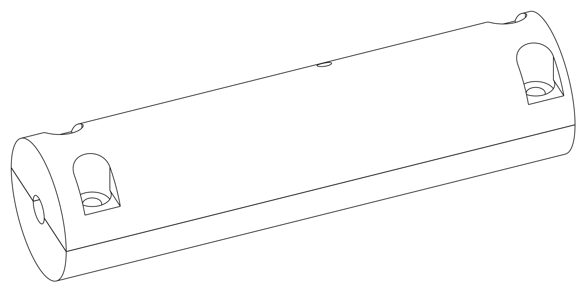
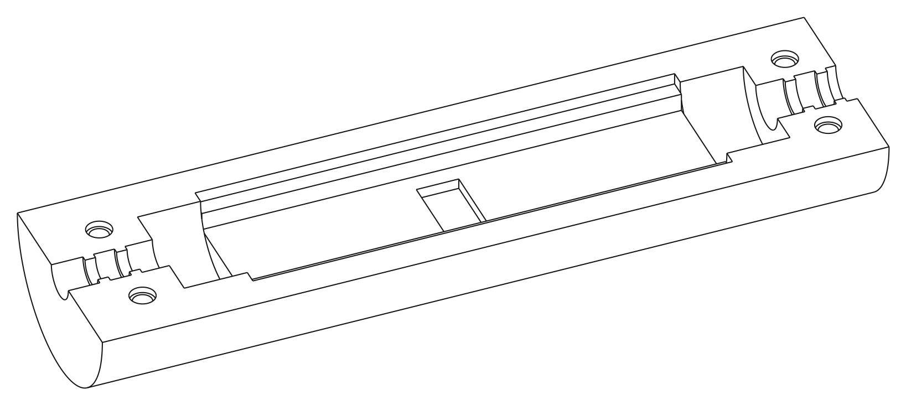
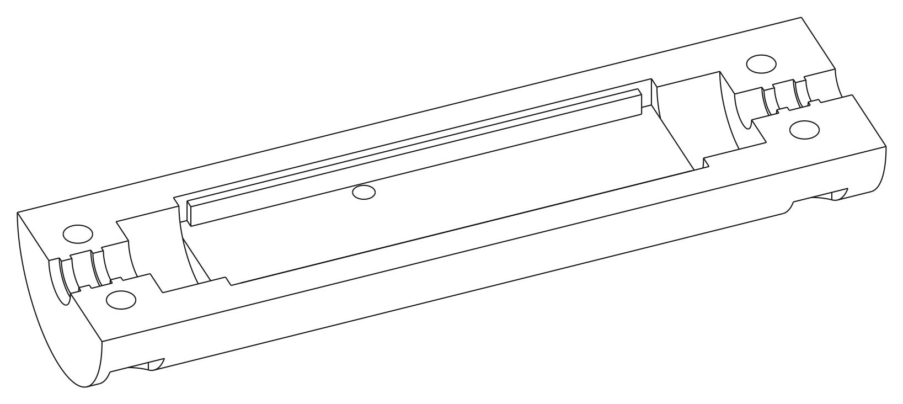

# Enclosure review pack — shell r1

2026-11-11. A two-part screwed shell for the dongle board, to be printed by
JLC3DP. **Nothing has been ordered or printed, and it should not be until you
have looked at this.** Everything needed to review it is here or in
`enclosure/out/enclosure.pdf`; no CAD program is needed.

## 1. What it is

A cylinder 20 mm across and 74.8 mm long, split lengthwise. The lower half
holds the board; the upper half is the lid. Four screws, two beside each
cable, pull the halves together and clamp each cable's jacket in a ribbed
collar. The trigger end is 2 mm longer than the amp end, so the lid's screw
holes line up only one way round.

Closed. The trigger end is on the left; the small hole on top is over the
LED:

Lower half. The board drops into the pocket, parts up, and rests on a ledge
along each long edge. The small pocket in the floor is for the programming
cable's pins:

Upper half, turned over end for end, so the amp end is on the left here. The
two long rails stop the board lifting. The small circle is the LED hole:

Dimensioned drawing, three pages: `enclosure/out/enclosure.pdf`.

| Page | Shows |
|---|---|
| 1 | Sections along the shell: on the centreline, and through one pair of screws |
| 2 | Six sections across it: both pairs of screws, a wire chamber, the programming footprint, the LED hole, a collar rib |
| 3 | The lower half from above, and a slice of the lid showing every opening in it |

Files for JLC3DP: `enclosure/out/lower.step` and `enclosure/out/upper.step`
(`.stl` copies are beside them).

## 2. Key sizes

All from `enclosure/params.py`, in millimetres. Sizes that belong to the
board or the cables are read from the board layout and `docs/cables.md`'s
data, not retyped.

| What | Size | Note |
|---|---|---|
| Outside | 20 diameter × 74.8 long | |
| Board pocket | 13.6 × 45.6 | 0.3 all round a 13 × 45 board |
| Room above the board | 2.5 | tallest part is 1.75 |
| Room below the board | 1.8 | for the wire runs between each strain-relief hole and its pad; cores are up to 1.08 |
| Ledge under each long edge | 1.3 of the board rests on it | |
| Rails over each long edge | stop 0.3 above the board | 0.4 clear of where any part can be |
| Wire chamber at each end | 6 long, 11 across | for the wires between the cable's end and the board |
| Trigger collar | bore 4, ribs 3 | cable jacket 3.7 ± 0.2 |
| Amp collar | bore 5.1, ribs 4.1 | cable jacket 4.8 ± 0.2 |
| Ribs | two per collar, 1.0 wide, 0.5 high | squeeze the jacket 0.35 all round at nominal sizes |
| LED hole | 2.0, about 5.9 deep | centred 27.98 from the board's trigger end, 4.7 from its centreline |
| Programming-pin pocket | 2.85 below the board | the pins come 1.6 through |
| Lid key | the trigger-end collar is 2 mm longer | turned end for end, the lid's screw holes miss the pilot holes by 2 mm |
| Thinnest wall | 1.2 | the walls at the ends of the screw-head recesses (the trigger end's outer one is 3.2), and the top of the wall beside each head; everything else is 1.25 or more |
| Plastic round the thread each screw cuts | 1.65 to the cable bore, 2.19 to the outside | JLC3DP asks for more than 1.5 round screws; the screw supplier for 1.2 |
| Plastic round the rest of each screw bore | 1.2 to 1.36 | clearance hole 1.25 and relieved mouth 1.35 from the amp cable's bore; head recess 1.36 from it; pilot hole's bottom corner 1.51 from the outside. See section 4 |

Screw and hole sizes are in section 5.

## 3. What has been checked, and what has not

`make enc-test` runs 58 checks. They build solids for the board, the space
parts may occupy, the wire runs, both cables, the screws and the programming
cable's pins, and intersect them with the two half-shells.

| Checked | How |
|---|---|
| The board drops in, rests on both ledges, cannot slide endways | intersection with the board solid and with probes at the ledges and ends |
| Nothing touches a part or a wire run, with 0.3 mm added all round for print tolerance | intersection with the grown keep-out solids |
| The LED hole is over the LED, not mirrored | a sight line at the LED's written-out position; the same line mirrored must hit plastic |
| The pin pocket is under the programming footprint and nowhere else | pins at the footprint's holes are clear; the same pins moved 6 mm either way hit the floor |
| Each collar suits its cable, and the wide one is at the amp end | the ribs must bite the right cable and pass the wrong one |
| How hard the ribs squeeze each jacket across both tolerances: 0.1 mm all round with the print 0.3 mm big and the cable at its thinnest, 0.6 mm the other way | arithmetic. Whether 0.1 mm grips and 0.6 mm closes is for the print to show |
| The lid goes on only one way round | turned end for end, a screw standing in any pilot hole is blocked by the lid |
| Screws pass the lid, seat, reach their pilot holes, and their heads stay inside the outline | intersection with screw solids |
| A PZ1 screwdriver's 4.5 mm blade enters the counterbore even if it prints 0.3 mm small | arithmetic |
| More than 1.5 mm of plastic round the thread each screw cuts, and at least 1.2 mm round the rest of each screw bore, with the print 0.3 mm small | arithmetic at each bore's worst corner |
| A screw cannot bottom out in its hole | 1 mm under its tip |
| Nothing else is cut away | each half's volume equals its half-cylinder less the listed cuts, within 0.5 mm³; a stray 1 mm hole is caught |
| The STEP files hold the same single solids | read back and compared |

Fourteen deliberately wrong shells were also tried by hand (LED hole
mirrored, collars swapped, no ribs, no pin pocket, low ceiling, no ledge,
rails touching the board, and so on). Each was caught by the check meant to
catch it; two checks that at first did not were tightened.

**Not checked, because only a print can:**

- Whether the screws hold in JLC3DP's nylon (section 5).
- How firmly the collars grip the real cables, and whether the 0.5 mm ribs
  print cleanly.
- Where JLC3DP's ±0.3 mm falls on the day.
- The cables' real jacket diameters. The collars use the makers' figures,
  3.7 and 4.8 mm. **Measure both cables with calipers before ordering**,
  put what you measure in `jacket_dia` in `hardware/design/cables.py`, and
  run `make enc`. Do this even for a small difference: the grip has little
  to spare at the thin end of the tolerances.

## 4. Decisions to check

**Changed since the plan you approved.** Each came from a check that failed.

| Change | Why |
|---|---|
| **20 mm across, not 18** | At 18 mm the plastic at the bottom outer corner of each pilot hole was 0.8 mm, and beside each screw head 0.9 mm. JLC3DP asks for more than 1.5 mm round screws. At 20 mm there is more than 1.5 mm round the thread each screw cuts, with the print 0.3 mm small. |
| **74.8 mm long, not 71.6** | 1.2 mm for the screwdriver: the head recess had to grow from 4.6 to 5.2 mm so that a PZ1 screwdriver's 4.5 mm blade fits, and each collar is 0.6 mm longer to keep 1.2 mm of wall each side of it. 2 mm for the lid key, below. |
| **The trigger end is 2 mm longer than the amp end** | Otherwise the lid could be screwed on the wrong way round, onto the wrong cable. Now its screw holes miss by 2 mm that way. |
| **Pilot holes are 6 mm deep, not 5.5** | So a screw cannot bottom out if the hole prints shallow or keeps powder. |
| **Each head recess is open on its outer side above the head** | A round hole down through a round surface leaves a wall that tapers to nothing. It is cut off where it would be thinner than 1.2 mm. |
| **The mouth of each pilot hole is widened to 2.4 mm for 0.6 mm** | The screw supplier's advice: plastic raised by the thread then cannot hold the halves apart. |
| **The LED hole is 5.9 mm deep, not 4.7** | It follows from the larger diameter. The LED is seen from straight above only. |

**As in the plan.**

- Four screws, two beside each cable, so each collar is clamped directly.
- Ribbed collars sized from the named cables.
- A pocket under the programming footprint, so the board can be flashed
  while it sits in the lower half with the lid off.
- The test pads are under the board. Probing them means lifting the board
  out.

**Two things for you to decide.** Both change the print, so decide before
ordering.

1. **Plastic round the unthreaded parts of the screw bores.** JLC3DP's rule
   is more than 1.5 mm round screws. The shell has that round the thread
   each screw cuts, which is where the load is. Round the clearance holes,
   the head recesses and the bottom of each pilot hole it has 1.2 to
   1.36 mm, which meets the general 1.2 mm rule but not the 1.5 mm one. I
   think that is sound. If you want 1.5 mm there too, the shell grows by
   about half a millimetre across and a millimetre or two in length.
2. **The LED hole.** It is 2 mm across and the LED is about 7.6 mm below
   its outer end, so the LED is seen only from within about 7° of straight
   above. Flaring the hole towards the outside would show it from an angle.
   Say if you want that.

The design document's section 8 has been updated to match the shell as
built.

## 5. Screws

The shell needs four screws. They cut their own thread in the lower half.

**Buy:** thread-forming screw for plastics, 2.2 mm × 8 mm, Pozi pan head.
The one the shell is sized for is Westfield Fasteners **WF67956**,
"2.2mm x 8mm Pozi Pan Thread Forming Screw for Plastics in BZP":
<https://www.westfieldfasteners.co.uk/Thread-Forming-Screws/Pozi-Pan-Thread-Forming-Screw-for-Plastics-2.2mmx8-BZP.html>

The page showed £1.57 excluding VAT on 2026-11-11 but did not say for how
many, or whether it was in stock. Check before ordering. Cromwell and
Boltworld list the same size.

**Screwdriver:** Pozidriv size 1 (PZ1).

| Figure | The screw | The shell | Source |
|---|---|---|---|
| Thread diameter | 2.2 mm | 2.6 mm clearance hole in the upper half | Westfield data sheet, table 1 |
| Head diameter | 3.9 mm | in a 5.2 mm counterbore; heads up to 4.2 mm fit | table 1 |
| Head height | 1.5 mm | head sits 3.0 mm above the split, below the outside surface | table 1 |
| Recess | PZ1 | the counterbore admits a PZ1 driver's 4.5 mm blade even if it prints 0.3 mm small | table 1; Wera 355 PZ 1 × 80 |
| Pilot hole in nylon | 0.75 × thread = 1.65 mm (PA 6 and PA 6.6) | modelled 1.8 mm, 6 mm deep; the screw's tip stops 1 mm short of the bottom | data sheet, table 2 |
| Plastic round the thread | boss 1.85 × thread = 4.1 mm across, so a 1.2 mm wall | 1.65 mm or more | table 2 |
| Thread engagement | at least 2 × thread = 4.4 mm | 4.4 mm | data sheet, "useful principles" |
| Mouth of the hole | chamfered or counterbored to the thread's diameter | 2.4 mm across, 0.6 mm deep | data sheet, "useful principles" |

Data sheet: <https://www.westfieldfasteners.co.uk/Standards/ThreadForming-PoziPan30.html>.
A second table of hole sizes for this type of screw gives the same 1.65 mm
for PA 6 and PA 6.6:
<https://cdn.shopify.com/s/files/1/0056/7856/3437/files/MetPTholesize.pdf>.

**The pilot size is untried.** Neither table lists PA 12, which is what
JLC3DP prints; PA 6 is the nearest. The hole is modelled at 1.8 mm, not
1.65 mm, because JLC3DP says its holes come out small and does not say by
how much. The first print settles it:

- If a screw turns without tightening, the holes are too big. Change
  `PILOT_D` in `enclosure/params.py` to 1.6.
- If a screw is very stiff, or the plastic beside it whitens or bulges, the
  holes are too small. Change `PILOT_D` to 2.0.

Before the first assembly, look down each pilot hole. If loose powder is
left in it, twist a 1.5 mm drill in by hand to clear it.

A screw that fits is one with a 2.2 mm thread, 8 mm long, and a head no
bigger than 4.2 mm across and 1.7 mm high. An ordinary self-tapping screw of
that size (DIN 7981, No. 2) would also go in, but its coarser thread loads
the plastic more; use the plastics type if you can get it.

## 6. Ordering from JLC3DP

1. Measure both cable jackets first (section 3).
2. Upload `enclosure/out/lower.step` and `enclosure/out/upper.step` as two
   files in one order. Units are millimetres. The sizes should read about
   74.8 × 20 × 10 for each.
3. Process MJF, material PA12 nylon. Black if it is offered, otherwise the
   natural grey; the colour does not matter.
4. Quantity 1 of each. Order 2 of each if you want a spare.
5. If JLC3DP queries thin features: no wall is under 1.2 mm. The collar ribs
   are raised rings 1.0 mm wide and 0.5 mm high, and are meant to be there.

I have not uploaded the files to JLC3DP, so its own checks and price are
not known.

## 7. Assembly

Do this after the board works (`docs/bring-up.md`, parts B and C). By then
both cables are soldered on, with about 17 mm of each core free beyond the
jacket (`docs/bring-up.md`, step A4). That length is what puts the end of
each jacket inside its collar.

1. **Lay the board in the lower half**, parts up, trigger pads towards the
   longer end with the narrower collar.
2. **Lay each cable in its collar.** The jacket must lie across both ribs,
   and its end should be in or near the wire chamber. If a jacket stops
   short of the second rib, push the cable in and let the cores bow in the
   chamber; they have about 3 mm to spare. If it still stops short, the
   cores are too long: shorten them and solder that end again.
3. **Tuck the loose ends into the chambers:** at the amp end the six spare
   cores, cut to different lengths so none can touch another, with the foil
   and drain wire trimmed back; at the trigger end the trimmed spiral
   screen.
4. **Fit the lid, longer end to the trigger cable.** Look down the LED hole:
   you should see the LED. Turned end for end the screw holes do not line
   up. If a screw will not start, the lid is the wrong way round; do not
   force it.
5. **Tighten the four screws** a little at a time, in turn, until the halves
   meet or the collars are firm, whichever comes first. Stop there: a
   thread cut in plastic strips if it is forced. A gap of a few tenths of a
   millimetre between the halves is acceptable.
6. Pull each cable firmly. Nothing should move.

The 17 mm figure is worked out from the wire's path, not tried. If the shell
arrives before you solder, check it first: lay the board and a cable in
place and mark the cores where they meet their strain-relief holes.

To flash later: take out the four screws, lift the lid off, and press the
programming cable onto the board where it sits. When refitting, turn each
screw backwards until it drops into its old thread, then tighten.

## 8. The first print: what to look at, and what to change

Each change is one number in `enclosure/params.py`. Then run `make enc`.
The checks pin the present sizes, so `make enc-test` will then report the
size you changed, and anything else the change upsets. Tell me what you
measured and changed, and I will bring the checks into line.

| If | Change |
|---|---|
| A screw turns without tightening | `PILOT_D` 1.8 → 1.6 |
| A screw is very stiff, or the plastic beside it whitens or bulges | `PILOT_D` 1.8 → 2.0 |
| The screwdriver will not go into a head recess | Use a PZ1 driver with a shaft of 5 mm or less (a 6.35 mm hex bit does not fit), and tell me: widening the recess means moving other sizes with it |
| A screw goes tight before the lid is down | It has bottomed in its hole. Clear the hole with a 1.5 mm drill. If the hole was already clear, tell me |
| The halves will not close on a cable | `RIB_BITE` 0.7 → 0.4 |
| A cable pulls through, or the ribs are faint | `RIB_BITE` 0.7 → 1.0 |
| The board rattles | `RAIL_GAP` 0.3 → 0.1 |
| The board will not drop in | `GAP` 0.3 → 0.5 |
| The lid rocks on the tallest part | tell me which part; `TOP_ROOM` is 2.5 |

## 9. Regenerating

| Command | Does |
|---|---|
| `make enc` | Rebuilds everything in `enclosure/out/` |
| `make enc-test` | Runs the 58 checks |

The shell is defined in `enclosure/params.py` (sizes) and
`enclosure/model.py` (shape). The files in `enclosure/out/` are generated;
do not edit them.
