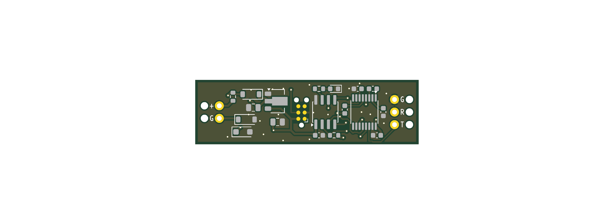
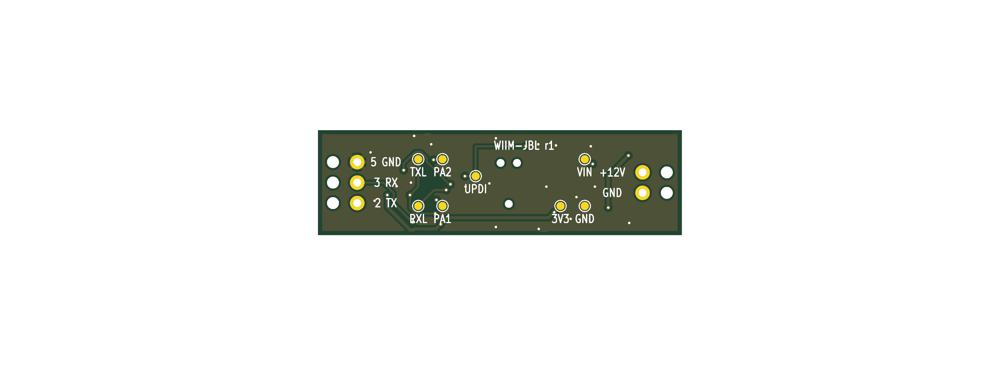

# Hardware review pack — board r1

2026-11-10. Everything needed to review the board is a PDF or a Markdown
file; KiCad is not needed. **The board has not been ordered and should not be
until you have looked at this.**

## 1. What to read

| File | What it is |
|---|---|
| `hardware/fab/schematic.pdf` | The schematic, one A3 page (legible printed on A4). Drawn with wires, signal flow left to right; ground and 3.3 V use the usual symbols. Each signal's name appears once, on its wire. |
| `hardware/fab/board.pdf` | The board, three pages at 5× scale: top copper and parts; bottom copper and labels; outline with dimensions. |
| `docs/hardware-calculations.md` | Power budget, voltages, dissipation, inrush, timing and ratings margins. |
| `docs/hardware-datasheet-review.md` | An independent check of every pin against the manufacturers' datasheets: 51 checks, no failures. |
| `hardware/fab/stock-report.md` | JLCPCB stock for every part, checked today. |
| `docs/cables.md` | Which two cables to buy, their wire sizes, and the check that the board's holes suit them. |
| `hardware/lib/README.md` | Where the programming footprint's pad order came from, and how the board is routed. |

Optional: open `hardware/dongle/dongle.kicad_pro` in KiCad 10.

Top side (parts are fitted here):

Bottom side (test pads and labels; nothing is fitted):

The pictures show the bare board. The container has no 3D models of the
parts, so they are not drawn; page 1 of `board.pdf` shows their outlines.

## 2. What changed from the design document

These are decisions made while building. Say if any of them is wrong.

| Design document | Built | Why |
|---|---|---|
| About 12 × 38 mm (limits 14 × 45) | **13 × 45 mm** | With 0603 parts on one side and a 4.85 mm wire-pad zone at each end, nothing smaller fits. It is at the length limit. Expect the shell to be about 19 mm across and 65–70 mm long. |
| Test pads, side not stated | **On the bottom** | No room on top. They are bare copper and not fitted by JLCPCB, so assembly is still one-sided. |
| Part names on the silkscreen | **Not printed** | No room between the parts. They are on page 1 of `board.pdf`. The silkscreen has `+ G` and `G R T` beside the wire pads on top, and the full legend underneath. |
| Routed by script | **Autorouted** (Freerouting), three connections by hand | The board is dense. The result is saved and checked by KiCad's own rule check. |
| 22 Ω input resistor | **100 Ω** | Keeps plug-in inrush at 117 mA, inside the trigger's 220 mA rating. Already in the design document. |
| One protection diode, in the supply wire | **A second one, D4, in the return wire** (added 2026-11-11) | With one diode, swapped trigger wires were harmless to the dongle but would have shorted the WiiM's trigger output through the shared ground. With D4 a miswire is harmless to both. Same part as D1; the board is still 13 × 45 mm. |

The wire pad labels underneath give the DB9 pin each wire goes to:
`2 TX` (dongle output, to the amp's pin 2), `3 RX` (from the amp's pin 3),
`5 GND`.

## 3. Checklist for your review

- [ ] The schematic does what you expect: 12 V in, 3.3 V regulator,
      controller, RS232 driver, LED, programming pads.
- [ ] Board size 13 × 45 mm is acceptable.
- [ ] Wire pads: 1.0 mm holes on 2.54 mm pitch, with a 1.5 mm strain-relief
      hole 3 mm outboard of each. Two at the trigger end, three at the amp
      end. These suit the cables named in `docs/cables.md`.
- [ ] The programming footprint (page 3 of `board.pdf`, centre 21.4 mm from
      the trigger end) is reachable with your TC2030-MCP-NL.
- [ ] Test pads underneath are acceptable: VIN, 3V3, GND, TXL, RXL (logic
      side of the serial lines), UPDI, PA1 (debug trace), PA2 (spare).
- [ ] The LED is at 27.98 mm from the trigger end, 1.8 mm from the top edge.
      The shell's light hole goes there.

### Hole positions

In millimetres from the board's top-left corner (trigger end on the left),
x along the length. All from the generated board file.

| Hole | Diameter | Plated | x | y |
|---|---|---|---|---|
| Trigger strain relief, `+` wire | 1.5 | no | 1.85 | 5.23 |
| Trigger strain relief, `G` wire | 1.5 | no | 1.85 | 7.77 |
| Trigger pad `+` | 1.0 | yes | 4.85 | 5.23 |
| Trigger pad `G` | 1.0 | yes | 4.85 | 7.77 |
| Programming footprint alignment | 0.99 | no | 20.38 | 4.06 |
| Programming footprint alignment | 0.99 | no | 22.42 | 4.06 |
| Programming footprint alignment | 0.99 | no | 21.40 | 9.14 |
| Amp pad `G` (DB9 pin 5) | 1.0 | yes | 40.15 | 3.96 |
| Amp pad `R` (DB9 pin 3) | 1.0 | yes | 40.15 | 6.50 |
| Amp pad `T` (DB9 pin 2) | 1.0 | yes | 40.15 | 9.04 |
| Amp strain relief, three holes | 1.5 | no | 43.15 | 3.96, 6.50, 9.04 |

Page 3 of `board.pdf` shows these holes but does not print their
coordinates.

## 4. Automated checks

All run by `make hw-test` (or `tools/dev pytest tools/tests hardware/tests -q`).
Result today: all pass (77 checks across the hardware and tools; the firmware has its own, `make fw-test`).

| Check | Result |
|---|---|
| KiCad electrical rules check on the schematic | 0 errors |
| KiCad's netlist of the schematic equals the circuit definition | equal |
| KiCad design rules check on the board | 0 errors, nothing unconnected |
| Schematic and board agree (KiCad parity check) | no differences |
| Remaining warnings | Only cosmetic kinds: KiCad's stock footprint libraries are not registered in the project; one silkscreen mark is clipped by a pad. |
| Tag-Connect rules: nothing between the pad rows, 0.5 mm clear of each pad, no vias under the footprint | pass |
| All fitted parts on top, at least 1 mm from the edge | pass |
| Bill of materials and placement file match the circuit | pass |
| Every part in stock at JLCPCB (`make stock`) | pass |

What these checks do not prove: that the part rotations in the placement
file are right for JLCPCB's machines (section 6), and anything that needs a
real board.

## 5. Known open points

| Point | Status | What to do |
|---|---|---|
| **Trigger polarity** | Not confirmed; tip-positive is the convention. | Meter the WiiM's jack before soldering. If the wires do end up swapped, D1 and D4 block and nothing is harmed (calculations, item 7); the dongle just does not start. |
| **Return current in the audio ground** | By my estimate inaudible (calculations, item 7); not measured. | Listen for ticks every 2 seconds with the volume up and nothing playing, at bring-up. |
| **Which DB9 pin the amp transmits on** | Inferred as pin 3. | With "RS232 Stdby" on, the amp's transmit pin idles negative against pin 5. If it is pin 2, swap the `TX` and `RX` wires. |
| **Regulator with a ceramic output capacitor** | Not stated by Holtek; widely done. | Scope the 3.3 V rail at bring-up. If it rings, fit a tantalum 10 µF at C2. |
| **LED orientation** | The LED's datasheet numbers its pins the opposite way to KiCad. The connections are right by function. | Check the LED in JLCPCB's placement preview (section 6). |
| **Part rotations for JLCPCB** | Taken from community tables; not verified. | Section 6. |
| **Wire and cable sizes** | The holes are checked against two named cables (`docs/cables.md`): 1.5 mm strain-relief holes for cores of about 1 mm, 1.0 mm solder holes for 24 and 28 AWG. The serial cable's core size is a typical figure, not a published one. | Buy those cables, and measure one core of the serial cable before soldering. Ordinary 22 AWG hook-up wire will not fit. |
| **Bare-board 3D model** | `hardware/fab/dongle.step` has no parts on it. | The enclosure will take part heights from datasheets: tallest is the SOIC-8 at 1.75 mm; allow 2.0 mm above the board and 1.5 mm below for the wire runs. |

## 6. Ordering from JLCPCB

1. Run `make stock` on the day. All parts must show enough stock.
2. Upload `hardware/fab/gerbers.zip`. Choose 2 layers, 1.6 mm, quantity 5.
   The size should read 45 × 13 mm.
3. Choose PCB assembly: economic, top side, 2 boards assembled.
4. Upload `hardware/fab/bom.csv` and `hardware/fab/cpl.csv`. Eleven part
   lines should match; none should be unmatched.
5. **In the placement preview, check each of these against page 1 of
   `board.pdf`, and rotate in the preview if wrong:**

   | Part | What to check |
   |---|---|
   | U1 (SOT-89) | The wide tab faces the amp end (right); the three legs face the trigger end. |
   | U2 (SOIC-8) | Pin 1 dot at the bottom-left of the part, nearest C3. |
   | U3 (TSSOP-16) | Pin 1 dot at the top-right of the part, nearest C4. |
   | D1 (Schottky, top row) | Cathode band towards the amp end (right). |
   | D4 (Schottky, by the trigger pads) | Cathode band towards the trigger end (left): the opposite way to D1. |
   | D3 (LED) | Cathode mark towards the amp end (right); the anode is next to R2. |
   | D2 (TVS) | Either way round; it is bidirectional. |

6. The controller is the only part with thin stock (2,142 today). If your
   account offers it, buy the two controllers into your JLCPCB parts library
   now. Alternates that fit the same footprint are in
   `hardware/fab/stock-report.md`; the firmware is sized to fit the ATtiny402.
7. One extended part (the controller) adds JLCPCB's extended-part fee. The
   TVS is "preferred extended"; whether that carries a fee is not confirmed.

## 7. Regenerating

| Command | Does |
|---|---|
| `make hw` | Rebuilds footprints, schematic, board and everything in `hardware/fab/`. |
| `make hw-test` | Runs every check above. |
| `make stock` | Re-checks JLCPCB stock. |
| `make route` | Re-runs the autorouter. Only needed after changing the circuit or placement. |

The circuit is defined in `hardware/design/circuit.py` and the placement in
`hardware/design/layout.py`. Never edit the files under `hardware/dongle/` by
hand.
